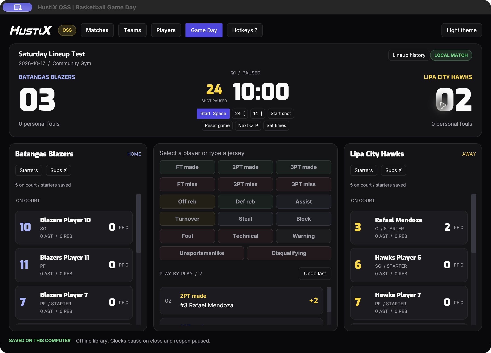

# HustlX OSS

Offline-first basketball Game Day for Windows and macOS, built around a Rust core and the HustlX web Game Day v2 experience.

**Status:** native Rust application in development. The Iced interface now supports a SQLite team/player library, roster editing, match creation and reopening, durable stat entry/undo, game/shot clocks, jersey/position profiles, supported web v2 hotkeys, starting lineups and confirmed substitutions. Exports and installers remain planned. The project license still needs a maintainer decision.

The interface uses the official HustlX wordmarks, Inter body text, Exo headings and Exo Black scores, bundled for offline use. See [branding](docs/branding.md).

## What we are building

- Manage teams, players, and rosters on your computer.
- Select Team A versus Team B without creating a league.
- Save matches with a name, date, and venue.
- Operate a basketball scoreboard, game clock, shot clock, lineups, and statistics offline.
- Reopen saved matches, view results and player statistics, and export files locally.
- Later, optionally sync with an eligible paid league on HustlX. Local game operation must remain independent of connectivity and subscription state.

## Try the local library

Run `cargo run --locked`, then:

1. Open **Players** and create players with optional default jerseys and positions.
2. Open **Teams**, create two teams, and assign players and optional jersey labels.
3. Open **Matches**, choose Team A and Team B, enter a name and date, optionally enter a venue, then create the match.
4. In Game Day, use **Starters** for each side, choose players, and save. Use **Subs X** to stage swaps, then confirm. Saved starters and current lineups survive restart.
5. Select a player or type a jersey to record a stat. Space starts/pauses clocks, `[` resets 24, and `]` resets 14. Open **Hotkeys ?** for the full guide.
6. Close the app, reopen it, and choose **Open match**. Both clocks reopen paused. See [clocks and shortcuts](docs/clocks-hotkeys.md) for correction and recovery behavior.

Team and player names and rosters are copied into each new match. Later library edits preserve its history. The library starts empty; screenshots use synthetic test data.

[Match library](docs/evidence/hustlx-branding/matches-dark.jpg), [light theme](docs/evidence/hustlx-branding/game-day-light.jpg), and [current visual evidence](docs/evidence/hustlx-branding/README.md). [SQLite verification](docs/evidence/sqlite-library/README.md) records the original create/restart journey. See [local storage](docs/storage.md) for data locations and save/retry behavior.

## Web UI reference

This is the existing web console rendered with sample data, not the desktop application:

[Basketball Game Day v2, dark mode](docs/references/basketball-game-day-v2-dark.jpg)

[Light-mode screenshot](docs/references/basketball-game-day-v2-light.jpg)

## Development

Install Rust with [rustup](https://rustup.rs/), then run `cargo run --locked`. SQLite is bundled; no database server is needed. See [development and verification](docs/development.md).

## Documentation

- [Branding](docs/branding.md): wordmarks, typography, palettes, and asset provenance.
- [Product brief](docs/product-brief.md): confirmed scope and open decisions.
- [Architecture](docs/architecture-proposal.md): implemented Rust/SQLite/clock boundaries and proposed sync.
- [Lineups and substitutions](docs/lineups-substitutions.md): starting players, swaps, history and save behavior.
- [Local storage](docs/storage.md): schema, data paths, snapshots, and failure handling.
- [Versioning and local packaging](docs/releases.md): macOS/Windows commands, dry-run and signing limits.
- [Roadmap](docs/roadmap.md): implementation slices and acceptance evidence.
- [UI reference](docs/references/README.md): capture provenance and visual parity notes.
- [Contributing](CONTRIBUTING.md): small changes, documentation, and verification expectations.

## Open-source preparation

This repository is intended to become open source. A license has not been selected yet; public visibility alone does not grant reuse rights. Choose and add the project license before accepting outside code contributions or publishing a software release. The Rust application is a new implementation; the private web application's source has not been copied. Bundled fonts retain their own license, documented in [third-party notices](THIRD_PARTY_NOTICES.md).
