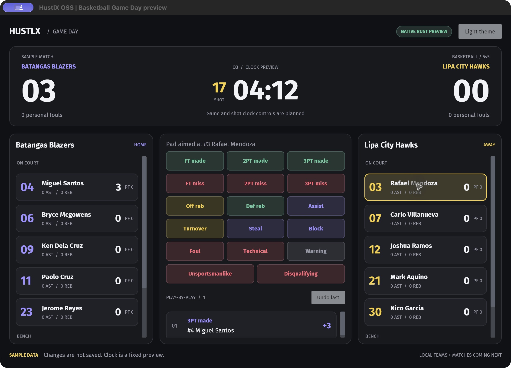

# HustlX OSS

Offline-first basketball Game Day for Windows and macOS, built around a Rust core and the HustlX web Game Day v2 experience.

**Status:** native Rust preview in development. The UI and domain logic use Rust throughout, with Iced for rendering. SQLite persistence, production clocks, match management, exports, and installers are not implemented yet. The project license still needs a maintainer decision.

## What we are building

- Manage teams, players, and rosters on your computer.
- Select Team A versus Team B without creating a league.
- Save matches with a name, date, and venue.
- Operate a basketball scoreboard, game clock, shot clock, lineups, and statistics offline.
- Reopen saved matches, view results and player statistics, and export files locally.
- Later, optionally sync with an eligible paid league on HustlX. Local game operation must remain independent of connectivity and subscription state.

## Native preview

The first native Rust console supports player selection, shot/stat recording, undo, and light/dark themes against an in-memory sample match:

[Light-mode native preview](docs/evidence/native-preview/light.jpg) and [verification evidence](docs/evidence/native-preview/README.md).

## Web UI reference

This is the existing web console rendered with sample data, not the desktop application:

[Basketball Game Day v2, dark mode](docs/references/basketball-game-day-v2-dark.jpg)

[Light-mode screenshot](docs/references/basketball-game-day-v2-light.jpg)

## Development

Install Rust with [rustup](https://rustup.rs/), then run `cargo run --locked`. The sample match is an in-memory preview; changes are not saved. See [development and verification](docs/development.md).

## Documentation

- [Product brief](docs/product-brief.md): confirmed scope and open decisions.
- [Architecture proposal](docs/architecture-proposal.md): Rust, persistence, UI, and future sync boundaries.
- [Roadmap](docs/roadmap.md): implementation slices and acceptance evidence.
- [UI reference](docs/references/README.md): capture provenance and visual parity notes.
- [Contributing](CONTRIBUTING.md): small changes, documentation, and verification expectations.

## Open-source preparation

This repository is intended to become open source. A license has not been selected yet; public visibility alone does not grant reuse rights. Choose and add the project license before accepting outside code contributions or publishing a software release. The Rust preview is a new implementation; the private web application's source has not been copied. Bundled fonts retain their own license, documented in [third-party notices](THIRD_PARTY_NOTICES.md).
