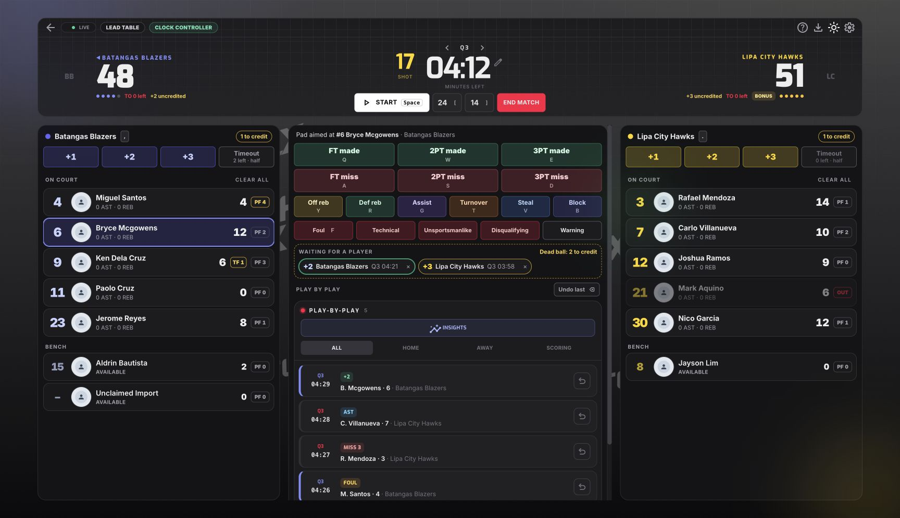

# HustlX OSS

Offline-first basketball Game Day for Windows and macOS, built around a Rust core and the HustlX web Game Day v2 experience.

**Status:** project discovery and documentation. There is no desktop application or installer yet. The proposed technology stack and license still need a maintainer decision.

## What we are building

- Manage teams, players, and rosters on your computer.
- Select Team A versus Team B without creating a league.
- Save matches with a name, date, and venue.
- Operate a basketball scoreboard, game clock, shot clock, lineups, and statistics offline.
- Reopen saved matches, view results and player statistics, and export files locally.
- Later, optionally sync with an eligible paid league on HustlX. Local game operation must remain independent of connectivity and subscription state.

## UI reference

This is the existing web console rendered with sample data, not the desktop application:

[Light-mode screenshot](docs/references/basketball-game-day-v2-light.jpg)

## Documentation

- [Product brief](docs/product-brief.md): confirmed scope and open decisions.
- [Architecture proposal](docs/architecture-proposal.md): Rust, persistence, UI, and future sync boundaries.
- [Roadmap](docs/roadmap.md): implementation slices and acceptance evidence.
- [UI reference](docs/references/README.md): capture provenance and visual parity notes.
- [Contributing](CONTRIBUTING.md): small changes, documentation, and verification expectations.

## Open-source preparation

This repository is intended to become open source. A license has not been selected yet; public visibility alone does not grant reuse rights. Choose and add the project license before accepting outside code contributions or publishing a software release. Only project documentation and sample-data UI screenshots are included here; the private web application's source has not been copied.
